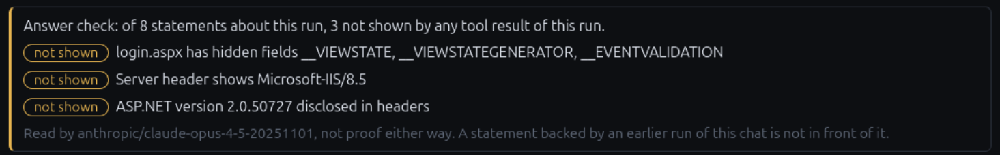

# HunterAI

A local, single-user AI workbench for bug hunting: chat, tools, and permissions. It runs
on your machine, listens on 127.0.0.1 only, and sends nothing about your use to anyone.

**For authorized security testing only.** Test what you own or have written permission to
test, inside the scope you were given; you are responsible for what you run with it. How
to report a flaw in HunterAI itself is in [SECURITY.md](SECURITY.md).


*A run against a public demo site built for security training: the goal the agent set, its
tool calls, two subagents working in parallel, and every step in the trajectory.*

| The answer check | What Caido recorded |
| --- | --- |
|  |  |


*Activity: what was called, how often, and what failed. Counted locally; nothing is sent anywhere.*

To start: copy `.env.example` to `.env`, put in one model key (or run Ollama), and see
[Run](#run). On a first start with no model, the interface opens a setup check that says
what is missing.

## What works today

- Chat with streaming, uploads, history grouped by target, search, edit-and-resend,
  retry, delete, and switchable message versions (nothing is overwritten).
- Models from abliteration.ai (default), Anthropic, OpenAI, Google, xAI, Ollama, and
  the Codex CLI, with per-model options.
- `claude_code`: Claude through the `claude` CLI and its own login (a Claude subscription),
  for people who have no API key. HunterAI starts `claude -p` in an empty folder with no
  tools, no MCP servers, and none of your Claude Code settings, and never reads the login.
  It has no tools in HunterAI, so its use is as the decision model (Settings → decision
  model) or for a chat that only needs answers. Each call starts a process: a decision
  took about 14 seconds on the machine this was written on, against one or two with an API
  key, and every call counts against the subscription's limits. Whether a subscription may
  be used by a program like this is for you to check in Anthropic's terms.
- Fallback: if abliteration.ai is unreachable, times out, or keeps rate-limiting before
  it has produced any output, the answer comes from a local Ollama model and is labelled.
  Bad key, no credits, and policy errors are shown as errors, never papered over.
- Tools: the model can read, write, edit, run commands, fetch, download, and search.
  Every call passes the permission engine first; "ask" shows you the exact call and
  waits for your answer. Codex chats have no tools.
- Trajectory per run: duration, turns, calls, tokens, and every model call, permission
  decision, and tool call. Survives restarts.
- Modes (plan, pentesting, coding) and targets with scope. Scope is enforced on tool
  calls: a host outside the target's scope always asks first.

- Orchestrator: the chat agent keeps a goal record, asks a decision model for
  probabilities instead of guessing, hands large tasks to subagents and checks what they
  claim against their own tool output, and records findings against the target.

- Knowledge base: named collections built from your files and folders, searched by meaning
  and by keyword, and pulled into a chat's answers with numbered, cited sources.

- Personas: prompt profiles for kinds of work (web and cloud, mobile, reverse engineering,
  internal networks, coding, personal assistant). Pick one in the chat header; edit them or
  add your own in Settings. A persona can name a starting mode, a preferred model, the
  tools it is offered (it can only narrow the list; permissions still decide every call),
  and knowledge collections to attach. The chat's mode still applies on top.

- Memory: after a chat has been quiet for about ten minutes, the worker asks the decision
  model for the few facts, lessons, and preferences worth keeping, and stores them with a
  link to the chat. Later messages get the matching notes as background (never as
  instructions; a note about one target is not shown in a chat about another). Settings,
  "Manage memory", lists every note to read, correct, delete, or add, and has the two
  switches (take notes, offer notes). Text that looks like a password, key, or token is refused (common shapes, not every secret). The memory collection is managed there, not under Knowledge. A note is
  what a model wrote down: it can be wrong.

- Browser tools: `browser_navigate`, `browser_click`, `browser_type` (network risk: they
  ask, naming the site), and `browser_read`, `browser_screenshot`, `browser_network`,
  `browser_console`, `browser_close` (read). Each chat gets its own headless Camoufox
  (Firefox) window with its own cookies; it closes after 15 minutes without use and when
  HunterAI stops. One "allow for this chat" answer covers the browser on that site. All
  of the browser's traffic goes through a filtering proxy inside HunterAI that checks the
  address of every connection (redirects, WebSockets, and workers included): nothing a
  page loads can reach this machine or your local network, or HunterAI's own API, unless
  the site you allowed is itself local, and then only on that host and port. The tab
  cannot be taken to a site you did not allow; a new tab a page opens is closed. A site
  you allowed stays allowed for the browser session of that chat, also after "once". Page
  text is given to the model as untrusted data. Needs the `camoufox` browser
  (`camoufox fetch` once).

## Knowledge base

Open **Knowledge** in the sidebar (Ctrl+Shift+K). A collection has one embedder, a local
Ollama embedding model (default `ollama:bge-m3`); its vector size is read from the model
when the collection is created.

- **Sources.** Files or a folder chosen in the browser (uploaded and staged); a folder or
  file path on this machine (read in place); a public GitHub or GitLab repository (shallow
  clone of the latest commit, no submodules, nothing in it runs, `.git` removed); a website
  (a crawl that stays on the URL's host, 200 pages and depth 2 unless you change them, one
  request every half second, robots.txt respected unless you switch that off, and never an
  address on this machine or network unless you tick the box that says the site is yours).
  A site that gives a single page (an API reference a script draws, for one) is asked for
  the text it publishes for language models: `/llms-full.txt`, else the pages `/llms.txt`
  lists, which are not followed further. Such a file the page links to on its parent site
  (`docs.acme.com` naming `acme.com/llms-full.txt`) is taken as well, under that site's
  robots.txt. An `llms.txt` given as the address is read as an index too.
- **Formats.** Text, Markdown, code, CSV, SQL, HTML, PDF; Word, Excel, PowerPoint
  (docx, xlsx, pptx) and OpenDocument (odt, ods, odp), read directly; pictures and PDF
  pages without a text layer by OCR (`tesseract`, English; `HUNTERAI_OCR=off` turns it
  off), marked as OCR text because it can contain errors. Old doc, xls, ppt, and rtf
  files are skipped unless `HUNTERAI_LEGACY_OFFICE=on` (that runs LibreOffice on them). zip, tar, tar.gz, tar.xz, gz, xz, and 7z are
  unpacked, up to three levels deep. Everything else is listed in the history as skipped,
  with the reason; nothing is dropped silently. A file that did not change since the last
  ingest costs nothing.
- **What is never read.** `.git`, `node_modules`, `__pycache__`, virtual environments,
  symlinks, files over 50 MB, and secret-like names (`.env`, `*.pem`, `*.key`, `id_rsa*`,
  `.netrc`, `.pgpass`): their text would end up in prompts.
- **Limits per job.** 50 MB per file, 2 GB of staged and unpacked data, 50,000 files. An
  archive that unpacks to more than 200 times its size is refused as a bomb. Paths that
  leave the archive, links, and device files inside archives are recorded and never written.
- **The worker.** Ingest runs in its own process (`python -m hunterai.worker`, started by
  the scripts), one job at a time, one embedding request at a time. Pause, resume, cancel,
  and retry work from the queue. If the worker or the machine dies mid-ingest, the next
  start continues the job: finished documents are not embedded again.
- **Disk.** A job fails with a disk-floor error, and can be retried, once less than 10 GiB
  is free. A failed job keeps its staged files until it is retried, cancelled, or 7 days
  old. As a rule of thumb, 1.5 million chunks need about 6 GB of vector files plus the chunk
  text in the database.
- **Vectors.** Qdrant in the container `hunterai-qdrant` on `127.0.0.1:6333`, data in
  `~/.hunterai/qdrant`; `scripts/qdrant.sh` starts it and it is left running
  (`docker stop hunterai-qdrant`). `HUNTERAI_VECTOR=memory` keeps vectors in the app
  database instead (exact search, fine for small collections, no container);
  `HUNTERAI_QDRANT_URL` points at another Qdrant.
- **In a chat.** "+ Knowledge" above the message box attaches collections to the chat. With
  "Always retrieve" on, every message first searches them (vector and keyword results
  fused), and the best passages that fit the context go to the model between
  `<<<KB_REFERENCE ... untrusted>>>` lines with the rule that they are data, not
  instructions. The answer cites them as [n], and "Sources" under it shows each passage.
  Without the switch, the agent can still look things up itself with the `kb_search` tool.
- **Looking inside.** Click a document in the list to read its chunks, correct one (it is
  embedded again), delete one, or remove the document from the index. "+ Note" adds text
  by hand. "Re-embed" embeds the whole collection again with another embedder, as a job;
  search finds less until it is done.
- A retrieved passage is evidence someone wrote, not a verified fact.

Before a document is chunked, strings shaped like keys, tokens, passwords, and private key
blocks are replaced by `[REDACTED:kind]` (Settings, "Knowledge base", to switch it off). A
retrieved passage that contains text shaped like instructions to a model is labelled so in
what the model reads. EPUB books and pages saved by a browser (`.mhtml`) are read; menus,
footers, and side boxes of a web page are left out when the page has a body without them.

### Discord notification for positive findings

With a Discord webhook address in `.env` (`DISCORD_WEBHOOK_URL`; `DISCORD_TOKEN` is read
too when it holds a webhook address), HunterAI posts to that channel when a finding is
positive: one the triage does not doubt (false-positive probability under 0.5), or one
that was set to "confirmed" by you or by the agent. Nothing else is announced: not runs,
not doubtful findings, not ones under the severity you set in Settings (low unless
changed). One message per finding, with its title, severity, status, the target's name,
and the triage figures. The evidence is never sent: it can hold tokens and personal data,
and Discord is someone else's server. A title cannot mention anyone. If Discord cannot be
reached the finding is recorded all the same, and the next change to it tries again.
Settings has the switch, the least severity, and "Send a test message".

### Activity: what was called, how often, at what cost

HunterAI has no telemetry: nothing about your use is sent to anyone. What it keeps is for
you, on your machine. **Activity** at the bottom of the sidebar counts, for a period you
pick, the runs, model calls and tool calls, the tokens in and out per model (and per call,
which is where a bloated chat shows), average durations, and what failed, by model, by
tool, and by day. It is counted from the trajectories of your chats, so deleting a chat
removes its runs from the counts.

For a record that outlives the chats there is `~/.hunterai/logs/activity.jsonl`: one line
per finished step (model call, tool call, decision, permission answer, fallback,
retrieval) with its time, name, outcome, duration and token counts. It holds no arguments,
no results, and no error text of tools, only the errors of model calls ("timed out"), so
it says what happened without holding a target's data. At 20 MB it is renamed to
`activity.jsonl.1` and a new one starts. `HUNTERAI_ACTIVITY_LOG=off` stops it.

### When a server is down: no hammering

A model can get stuck asking a dead server for the same thing until its turns are spent.
Each agent (the main loop of a run, and every subagent) keeps count. The same call that
failed twice in a row with the same result is not run a third time: the model is told to
do something else. A host whose answers have all been server errors (5xx), rate limits
(429) or timeouts gets a line added to the result from the fourth failure in a row, and is
not called again in that run after the eighth; one good answer from it clears the count. A
call that succeeds can be repeated freely. Only tools that name their host are counted per
host (`web_fetch`, the browser, `caido_send`); what a shell command does is not looked into.

### Sending a message while the agent works

You do not have to stop a run to tell the agent something. While it works, the Send button
becomes **Queue**: your message is kept, shown above the composer, and handed to the model
with its next model call, after the tool it is running has finished. Nothing is
interrupted. The model receives it at the end of the last tool result, inside a block
marked with a code that is made on your machine for that chat and named in the system
prompt; only a block with that code counts as you, so a web page or a file cannot pose as
you by imitating it. The hand-over is a step in the trajectory ("message from you"). If
the run ends before the agent takes another step, what is still waiting is sent as your
next message; after a stop or an error it stays in view for you to send or remove. Queued
messages are text only.

### A chat longer than the model's context window

Every model call sends the whole chat. A chat that has outgrown its model's window is
refused by the provider, and so is every message after that one. Before a call that comes
close to the window, HunterAI makes the request smaller, in this order:

1. old tool results are cut down to their first 300 characters, oldest first (the latest
   four stay whole while there is room for them);
2. the older turns are replaced by a summary that the chat's own model writes. The summary
   is kept and used again for the calls after it.

Only the request changes. What is stored, and what you see in the chat, stays whole, and
the trajectory says on the model call what was done ("made to fit its context: ...").
The window comes from the provider's model list. Where a provider does not say, the first
refusal for size teaches it: the request is halved and the call is made once more. A
summary is a model's account of the earlier part, so it can leave something out; a cut-down
result says how long it was, and the tool can be run again. Subagents are not covered (they
stop after 12 turns). The Anthropic list no longer offers the models before Claude 4.6,
whose window is 200K tokens; a chat that already uses one keeps it.

### Answer check

After a run in a chat that has tools, the decision model reads the final answer next to the
tool results of that run and lists the answer's statements about what was run, fetched, or
found that no result shows ("not shown") or that a result contradicts ("contradicted", with
the words of the result). They are marked under the answer; an answer whose statements are
all backed gets one quiet line, and one that claims nothing about the run gets none. The
chat model never sees the list. It is a second model's reading, not proof: a statement
backed by a result of an earlier run of the chat is not in front of it, and it is only as
good as the decision model you chose. It costs one call to the decision model per run and
is recorded as the step "answer check"; Settings switches it off.

### The same source twice, and the queue

Adding a repository, a website, or a folder that the collection already has is refused with
the date and the number of files of the earlier ingestion; the interface then asks whether
to ingest it again, which is how you pick up changes. A source that is still in the queue
is never queued a second time. A finished entry of the queue has an ✕ that removes the
entry only, and "Remove duplicate entries" clears the older finished runs of sources that
were ingested more than once; what was ingested stays in the collection either way.

Embedding thousands of files holds a laptop's processor at full load for a long time. Before
each batch the job reads the processor temperature, and at `HUNTERAI_MAX_CPU_TEMP` (90 °C
unless set; `off` disables it) it waits until the temperature is five degrees under that,
then goes on. The entry in the queue says "cooling down" with the temperature meanwhile.
The job takes longer; the machine does not switch itself off in the middle of it.

While a repository is cloned or a site is crawled, the entry says so and how much has been
downloaded, and an entry that has not started says it is waiting its turn (one job runs at
a time). A job survives a crash or a reboot: when the worker starts again it takes up every
job that was running. Files that were already embedded are not embedded again; a clone or
crawl that was cut off is thrown away and done again from the start, so a half-downloaded
file is never read.

## Orchestrator

When the orchestrator sets a goal record (the `focus` tool), a panel appears above the
messages and stays there: the objective, the open items, the items it has taken off its
open list (shown as done: that is the agent's own word, not a check), and the subagents of
the run on screen with their state and whether their answer was verified. It folds to one
line.

| Tool | What it does |
|---|---|
| `decide_check`, `decide_classify`, `decide_score`, `decide_gate`, `decide_decide`, `decide_rank` | Ask the decision model a yes/no, a choice, a score, a risk screen, several questions at once, or a ranking. The answer is probabilities plus an action: act (confidence 0.8 or more), review (0.5 or more), abstain. An answer that cannot be used is marked invalid and is never "act". |
| `focus` | The chat's goal record: objective, success criteria, open items. It is part of every request, and `check` says how far a next step drifts from it. |
| `critique` | A second look at a claim or plan: assumptions, alternatives, what would disprove it. Labelled as the model's analysis. |
| `finding_add`, `finding_update`, `finding_list` | Findings for the chat's target. Adding one runs a triage first (severity, false positive, in scope, duplicate), stored with it. |
| `delegate` | Runs a subagent on a brief with a subset of the chat's tools: at most 12 model turns, 8 subagents per run, one at a time, never nested. Its calls pass the same permission engine and its questions appear in the same chat. |
| `swarm` | Runs 2 to 6 such subagents on independent briefs, three at a time unless you set another number (Settings, 1 to 6: more load this machine and your provider's rate limit); each answer is judged on its own. Cloud models only: with a local chat model or a local decision model it is refused and `delegate` is the tool, because this kind of machine cannot run two local models at once. A swarm member has no fallback to the local model, no browser (a chat has one), and no `look_at_image`. |

- **Verification.** When a subagent finishes, the decision model judges its answer against
  the tool output in its own transcript. Only a confident "accept" is reported as
  verified; anything else, including a verdict that could not be obtained, reaches the
  chat agent as unverified with the instruction to check it.
- **Risk gate** (Settings, on by default). Before a write, edit, or execute call the
  decision model scores the risk. It is advice: under "ask" you see it in the prompt;
  under "allow" a recommendation other than allow, or an unusable answer, makes the call
  ask. It never approves a call, and a call you allowed for the chat is not screened
  again. If the decision model cannot be reached the call keeps its decision and the
  trajectory says the gate failed. Each screened call costs one decision-model call.
- **Decision model** (Settings). Its own provider and model, or the one new chats use;
  abliteration.ai falls back to the local Ollama model as chats do.
- The trajectory shows every decision with its numbers; a subagent's steps are indented
  under its `delegate` step. "Goal" in the chat header shows the goal record and the
  target's findings.

A decision is a model's estimate. The numbers say how sure the model is, not how right.

## Tools

| Tool | Risk | What it does, and its limits |
|---|---|---|
| `read` | read | Reads a file through the bundled file chunker, 12,000 characters per chunk, so a file of any size is read in full. Line ranges and searches return at most 24,000 characters. Without the chunker: a plain read, 200 lines per call. |
| `write` | write | Creates or replaces a file (2 MiB at most). The prompt shows the diff. |
| `edit` | write | Replaces an exact string (2 MiB files at most). The prompt shows the diff. |
| `execute` | execute | Runs `bash -c` on this machine. Default timeout 120 s, at most 1800 s. Background processes: 8 per chat, 64 MiB of output each. |
| `process_output` | read | Reads a process's output from an offset, 24,000 bytes per call. |
| `process_input` | execute | Sends text to a background process. Always asks. |
| `process_kill` | read | Ends a process this chat started, with its whole process group. |
| `web_fetch` | network | GET or POST, 2 MiB of response, 1 MiB of request body, 5 same-host redirects, 120 s in all. |
| `web_download` | network | Saves a URL into `<working folder>/downloads`. 200 MB by default, 2048 MB at most; refuses when free disk would fall under 10 GiB. |
| `web_search` | network | Searches through the local SearXNG container. |
| `repo_search` | read | ripgrep under a folder. Files that usually hold credentials are never searched. |

A result longer than 30,000 characters reaches the model as its first 22,000 and last
8,000 characters, with the path of the file that holds all of it.

### Permissions

Each call is decided as allow, ask, or deny. The first of these that is set wins: the
chat's setting for the tool, the chat's setting for the risk class, the global setting
for the tool, the global setting for the risk class, the mode preset.

| Mode | read | write | execute | network |
|---|---|---|---|---|
| plan | allow | deny (fixed) | deny (fixed) | ask |
| pentesting | allow | ask | ask | ask |
| coding | allow | ask, allowed inside the working folder | ask | ask |

Whatever the setting, these always apply:

- The project `.env` is never read or written by a tool. The database, `mcp.json`, and
  the folder of the bundled MCP servers are never written.
- A call that carries one of HunterAI's API key values is denied.
- A host on the target's out-of-scope list, a host not on its in-scope list, an address
  on this machine or the local network, a path that usually holds credentials, and
  arguments with invisible characters each force an ask with a warning.
- A tool can never call HunterAI's own API. A shell command that names it always asks.

"Allow for this chat" covers one tool and one target: `execute` the exact command in
the same folder; `web_fetch` and `web_download` one method, scheme, host, and port;
`read`, `write`, `edit`, and `repo_search` one path; `web_search` all searches; an MCP
tool the identical arguments. It is not offered for `process_input`, for a host on the
out-of-scope list, or for a command that addresses HunterAI's own API. Changing the
chat's mode or target clears these, and any file write clears the ones for commands.

**Auto-approve** (the button in the chat header) is one chat's switch for "stop asking".
With it on, a call runs where only the mode preset or a global setting says ask. It lifts
no deny, and no ask you set for that chat (set one tool to ask in its Permissions panel to
keep a question for it). Everything in the list above still applies, the risk gate still
screens calls when it is on, and one more rule comes with it: a host a call names is
covered only when the chat's target lists what is in scope. With no target, or a target
with an empty in-scope list, every named host still asks. Subagents follow the chat's
switch. Switching it on shows what it means and asks you to confirm; a command can reach
hosts it does not name, so this is for work you are authorised to do and are watching.

The **working folder** of a chat is where relative paths, commands, and downloads go:
`~/.hunterai/work/<chat id>` unless you set another absolute folder in the chat's
Permissions panel. Deleting a chat removes the default folder, never a custom one.

### Known limits

- An approved `execute` command runs with the owner's full rights. It can read files, call HunterAI's own API with `curl`, or `setsid` away from its process group. The guard is the ask that shows the exact command and cwd; host and path detection on a command string is a heuristic that only adds warnings or denials.
- Scrubbing covers HunterAI's five keys. Other variables in the same `.env` file are never read, so their values cannot be scrubbed; the file tools hard-deny the env file instead. Variables of other tools in the process environment are kept from commands when you list their prefixes in `HUNTERAI_PRIVATE_ENV` (for example `MYTOOL_,INTERNAL_`).
- Path and host detection for MCP tools is by argument name and URL shape. An MCP tool can touch things its arguments do not name; that is why unknown servers default to `execute` = ask.
- A grant remembers only that a warning was shown with it, not which one. Within one call the runner asks again for a warning the owner has not seen, and a change of mode or target clears the grants; between those, a call granted under one warning can pass a different warning later (for example a granted host name that starts resolving to a local address). HunterAI's own API stays denied in every case.
- `read` checks the path and then hands it to the chunker, which opens it itself. A symlink swapped in between is not caught (`write` and `edit` do re-check).
- In coding mode with a command allowed "for this chat", the grant ends at the next file write, so an edit-then-test loop asks each time. Setting `execute` to Allow for the chat in the Permissions panel is the deliberate way to stop those prompts.
- A process that writes very fast can pass the 64 MiB output cap for a moment (about one check interval, 0.2 s) before it is killed; its log is then cut back to 64 MiB.

### Things that may surprise you

- A redirect to another host is reported to the model, not followed; the new host gets its own decision.
- No DNS query is sent for a host until the call is allowed, so the first prompt can show "not resolved yet" and a second prompt can follow when the address brings a new warning.
- A host on a domain allowlist is not flagged as outside the target's scope. Loopback is never a scope matter, but it does ask as a local address.
- A host name on a domain allowlist still asks when it resolves to this machine or the local network; only an IP, a CIDR, or `localhost` entry stops that prompt.
- Out-of-scope path entries match without regard to case or doubled slashes, so a near miss still warns.
- `web_search` is not checked against scope: the query goes to search engines, not to the target.
- A background process ends when its shell exits, when you kill it, when its chat is deleted, or when the app stops. A foreground command shows its output when it ends.
- A run stops after 25 model turns (Settings), after 3 invalid tool calls in a row, and runs at most 20 tool calls per turn.
- A run waiting for your answer has no timeout. If the app stops meanwhile, the run ends as interrupted and the call does not run.
- Fallback to Ollama happens only on the first model call of a run; after a tool has run, a provider error ends the run.
- The model can end this chat's own processes without asking.
- The development page (`scripts/dev.sh`, port 5173) is accepted by the API only in development.

### MCP servers

`~/.hunterai/mcp.json` lists extra servers. HunterAI reads it at start:

```json
{"servers": {"scanner": {"command": "scan-mcp", "args": [], "env": {}, "risk": "network"}}}
```

Fields: `transport` (`stdio` or `http`), `command`, `args`, `env`, `cwd`, `url`, `risk`
(`read`, `write`, `execute`, `network`; default `execute`, so every call asks),
`enabled`, `expose`. Tools appear as `<server>_<tool>`. The file chunker is bundled as
the server `chunker` and hidden from the model: `read` is the only way to it. Only its
`enabled` and `env` can be changed here.

Two more servers are bundled and off until you turn them on in Settings (or with
`"enabled": true` here), because each adds many tools to every request: `rea`
(`npx -y rea-agents@6.7.0 mcp`, reverse engineering, risk `execute`: every call asks) and
`context7` (`npx -y @upstash/context7-mcp`, library documentation, risk `network`). Both
need Node.js, and the first start downloads the package. Turning a server on or off in
Settings restarts that server only.

**Managing servers** (Settings, "Manage MCP servers"). The list shows every server with
its state; each can be switched, checked (restart, ping time, what it printed, and a hint
when the output looks like a missing runtime, dependency, or key), edited, or removed.

"Add from a repo, package, or config" takes a GitHub or GitLab URL, an npm package
(`npm:@scope/name`, with a version or a tag after it if you want one: `@1.2.3`, `@latest`),
a PyPI package (`pypi:name`, or `pypi:name==1.2.3`), an npmjs.com or pypi.org page, a
folder path, or a pasted `{"mcpServers": ...}` block. A tag is read once, here: the server
is pinned to the version the tag named that day. A command line, a range of versions, or a
bare name is refused with what to type instead (`npx -y @scope/name /folder` is answered
with `npm:@scope/name`; the start options go in the next step). HunterAI then:

1. downloads the code and reads it. Nothing from it runs.
2. checks it: rules for install scripts, hidden or encoded code, reads of keys and
   credentials, text that tries to instruct the model, paste and webhook endpoints, and
   the like, each with file, line, and excerpt; plus the dependency versions it pins
   against the OSV vulnerability database (only package names and versions are sent).
   You can ask the decision model to read the findings; that is a model's advice.
3. shows the exact install steps and start command, the settings the code reads from its
   environment, and a name and risk class you can change.
4. on your approval runs those install steps (install scripts off, none of your API keys
   in their environment) and adds the server, switched off. Switching it on is what
   starts its code.

A repository in Node or Python is installed with npm or uv. A Go module is built with
`go build` (the program under `cmd/` named after the repository, or the one at its root)
and started with the options its README gives for that program; the build runs with cgo
off, and the modules in `go.sum` are in the dependency audit. When the module asks for a
newer Go than this machine has, the inspection says so and the build step names that
version: go then downloads exactly that toolchain from the Go project (about 70 MB, kept in
your Go cache) and builds with it. No other toolchain is ever fetched. A repository with no program to start whose README names a hosted server (an
`https` address) is proposed as that address, with a note of the header it asks for; the
same address is offered next to a Go build, since using it builds nothing here.

A check that finds nothing is not proof that a server is safe. Keep the risk class
`execute` (every call asks) for code you have not read. A pasted configuration is not
checked at all: there is no code to read until its command runs.

#### Large servers: tools on demand

Every tool a server offers is sent to the model with every request, description and
argument schema included. A server with 200 tools is tens of thousands of tokens before the
conversation starts. So the tools of a server with more than 15 are not put in the tool
list. The model is told their names in one short block of the system prompt, gets a tool's
description and schema from `mcp_find` when it wants one, and runs it with `mcp_call`.
`mcp_call` is replaced by the tool it names before any rule is applied: the schema check,
the scope check, the permission question, the risk gate, and the trajectory all see that
tool, as if the model had called it directly. A tool the scanner holds stays unreachable
either way. "Load the tools of large MCP servers on demand" in Settings switches this off;
the price is one extra model turn the first time a tool is looked up.

#### The scanner

The checker reads a server's code before it is installed. The scanner reads what a running
server tells the model: every tool's name, description, and argument schema, each time the
server starts. It looks for the known shapes of a poisoned tool (text that gives the model
orders, invisible characters, requests for key files or the conversation, paste and webhook
hosts, mentions of other tools) and it remembers what you accepted (`~/.hunterai/mcp-pins.json`).

- The first time a server is seen, tools with no high finding are accepted; a tool with one
  is held: it is not offered to the model until you read it and accept it.
- After that, a tool that is new or whose definition has changed is held, with the old and
  the new text side by side. A changed start command makes the server "first seen" again.
- Settings, "Manage MCP servers", **Scan** shows the report; a held tool has an accept button.
- A server whose tools are never offered to the model (the file chunker) is scanned, not held.

Nothing found is not proof of safety. The scanner reads definitions; it does not see what a
tool does when it runs, or what it returns.

#### Remote (http) servers

"Add by hand" with a URL and no command adds a Streamable HTTP server. Headers (an
`Authorization` value, usually) are stored in `mcp.json`, never shown again, and sent only
over https or to this machine. A remote server sees every argument the model sends it.

A header value may name a key of the `.env` file instead of holding it: `Bearer ${ACME_API_KEY}`
is filled in when the server is contacted, so the key stays in one place. A server that
answers 401 or 403 is shown with what it asks for; one that only takes an OAuth sign-in in
a browser cannot be used yet.

### Known vulnerabilities (`cve`)

The `cve` tool asks public databases instead of the model's memory, with no key: the NVD
(what a CVE is and which versions it affects), CISA's Known Exploited Vulnerabilities list
(is it used in real attacks), and FIRST's EPSS (how likely it is to be exploited). Three
actions: `product` (the CVEs of a product at an exact version, by the NVD's one-word name,
for example nginx 1.18.0), `search` (keywords, when there is no version), and `lookup`
(details and references of up to five ids). Those CISA lists as exploited come first, then
the likelier, then the more severe. The model is told never to name a CVE id that a `cve`
result did not give it, and each result says that a matching version is a lead to confirm
on the target, not a finding. The NVD is slow (10 to 30 seconds a call is usual) and allows
five requests in 30 seconds without a key; `NVD_API_KEY` in `.env` is sent when set. The
CISA list is kept for a day in `~/.hunterai/cache`.

### Profundis

With `PROFUNDIS_API_KEY` in `.env`, the `profundis` tool searches Profundis scan data:
hosts, dns, vhosts, whois, subdomains, one domain's addresses, ASN. Every call spends
credits of your account; the permission prompt says how many, and "allow for this chat"
is per action. A subdomains call is capped at 3 credits unless the model asks for more
(at most 50). Without the key the tool is not offered. It has not been run against the
live API yet: the request and answer shapes follow the published API description.

### Images for a model without eyes

`look_at_image` lets a chat model with no image input ask a local model that has it
(through Ollama) to describe a screenshot, an image file, or an image attached to the chat
(`upload:<id>`, named in the placeholder such a model gets). The answer is the description
plus the text tesseract reads in the picture. The model is the one set in Settings,
"Images", or the first installed model Ollama lists with the vision capability; it gets an
explicit context size, waits for the lock the embedder uses, and stays loaded for two
minutes after an answer, so that a run of pictures loads it once (`HUNTERAI_VISION_KEEP_LOADED`
sets the seconds; `0` unloads it after every answer). A description is a model's reading: it can be wrong, above all on small text.

Such a model fills in what it cannot read. So the tool asks for one picture per call at its
original size (in a shrunken video frame, a thumbnail, or a sheet of many pictures the text
is gone, and the model invents it), and the result says how large the picture is, how many
of the texts the model quotes OCR read as well (naming the ones it did not, when it read
most of the others), and where a description ran into a loop and lines were dropped. The
text OCR read is also given to the model, to spell what it sees.

A local model is not loaded while the processor is hotter than 90 C: the call waits up to a
minute for it to cool, then answers with the OCR text alone and says why. A laptop cuts its
power at the processor's critical temperature without a line in any log.
`HUNTERAI_MAX_CPU_TEMP` sets the limit in C (`off` removes it).

### Caido

HunterAI runs its own [Caido](https://caido.io) (the `caido-cli` program, found on the PATH,
at `~/.hunterai/bin/caido-cli`, or where `HUNTERAI_CAIDO_BIN` says) on
`http://127.0.0.1:8791` (`HUNTERAI_CAIDO_PORT`), started the first time a tool needs it and
left running. Open that address in a browser and continue as a guest to watch the traffic.
Its data is in `~/.hunterai/caido`, its output in `~/.hunterai/caido.log`.

- `caido` (a read): `status`; `requests`, the recorded requests, newest first, filtered
  with HTTPQL (`req.host.cont:"acme.com" AND resp.code.eq:403`); `request`, the raw request
  and response of one.
- `caido_send` (a network call, asked about and checked against the target's scope like
  `web_fetch`): one raw HTTP request, sent by Caido, answered with the raw response. The
  model reads a recorded request, edits the text, and sends it.

The same port is the proxy: `curl -x http://127.0.0.1:8791 -k <url>` in a command is
recorded too. With "Send the browser and web_fetch through Caido" switched on in Settings,
the browser tools and `web_fetch` go through it as well: every request a page makes and
every page the agent fetches is in the history, and a `web_fetch` result says that it was
recorded. Caido reads https by answering with its own certificates, so the browser and
`web_fetch` stop checking a site's certificate while that is on. When Caido cannot be
reached, `web_fetch` goes out directly as before and its result says it was not recorded.
`web_download` and commands of the shell tool are not recorded. With the `caido` tool on
offer, the model is told to read the history after it browsed or fetched pages of a target.

### Programs for the rea server

The bundled `rea` server (reverse engineering) can use Ghidra, Hopper, JADX and other
programs it does not ship. Put them, or links to where they are installed, in
`~/.hunterai/rea`, and HunterAI hands each to REA when it starts the server:

| In `~/.hunterai/rea` | What it must hold | Given to REA as |
| --- | --- | --- |
| `ghidra/` | a Ghidra installation (`support/analyzeHeadless`) | `GHIDRA_INSTALL_DIR` |
| `jdk/` | a JDK for Ghidra (`bin/java`) | `JAVA_HOME` |
| `hopper/` | Hopper (`bin/Hopper`), or the launcher itself | `HOPPER_LAUNCHER_PATH` |
| `ilspycmd` | the ILSpy command line program | `REA_ILSPY_CMD_PATH` |
| `adb` | Android's adb | `REA_ADB_PATH` |
| `bin/` | programs REA finds by name: `jadx`, `rizin`, `apktool` | first on its `PATH` |

A folder may be the installation or hold exactly one folder that is (an unpacked archive).
A name that does not hold what it should is ignored. Nothing is downloaded. Switch the rea
server off and on after a change; the setup check lists what was found. IDA is not covered:
REA reaches it through an IDA MCP bridge of its own (`REA_IDA_MCP_CONFIG`).

### Your tool folder

HunterAI ships no external security tools: which ones you use is yours to choose and to
download. Programs you put in `bin/` in the HunterAI folder (files or links, executable)
are found by name in every command the shell tool runs, ahead of the rest of the PATH, and
the model is told which ones are there. For the well-known ones (nuclei, httpx, subfinder,
katana, naabu, dnsx, ffuf, gitleaks and others) it is also told what each is for. Create
the folder yourself; git ignores it, so nothing in it is ever committed. `~/.hunterai/bin`
works the same way and comes second; a name in both is taken from `bin/`.

```bash
mkdir -p bin
ln -s ~/go/bin/* bin/          # for example: the tools you installed with `go install`
```

There is no wrapper and no MCP server in between: the model writes the command, and the
shell tool's permissions decide whether it runs. That also keeps requests small: a program
costs its name in the prompt, where an MCP server costs every one of its tool definitions
in every request. The setup check lists what the folders hold.

### Web search

`scripts/start.sh` starts the container `hunterai-searxng` on `127.0.0.1:8888` with its
settings in `~/.hunterai/searxng/settings.yml`. It is left running when HunterAI stops;
`scripts/searxng.sh stop` stops it. `scripts/check-tools.sh` lists what the tools need.

### Variables

`HUNTERAI_MCP=off` starts no MCP server. The file chunker MCP server ships with HunterAI
(`backend/hunterai/mcp_servers/file_chunker_mcp.py`); `HUNTERAI_CHUNKER` points at another
chunker file. `HUNTERAI_SEARXNG_URL` points at another SearXNG. `HUNTERAI_DEV=1` (set by
`scripts/dev.sh` only) lets the Vite page on port 5173 call the API.

## Requirements

Python 3.12 via [uv](https://docs.astral.sh/uv/), [Bun](https://bun.sh), and optionally
[Ollama](https://ollama.com) for local models and the fallback.

## Run

```bash
scripts/start.sh   # build the interface, then serve everything on http://127.0.0.1:8790
scripts/dev.sh     # development: hot reload on http://127.0.0.1:5173
```

The server listens on 127.0.0.1 only. Set `HUNTERAI_PORT` to use another port.

On a start with no model to talk to (no API key, and no chat model in Ollama) the interface
opens a **setup check**: one line per part (a model, Ollama, the embedding model, Qdrant,
SearXNG, Caido, Camoufox) with what was found and the command or place that fixes it. Only
the model is required; each other line switches one feature on. It is under Settings →
"Setup check" at any time.

The bottom of the sidebar shows the processor temperature and the local models Ollama holds
in memory, asked again every ten seconds. The line turns yellow within ten degrees of
`HUNTERAI_MAX_CPU_TEMP` and red at it. **Findings** next to it lists every finding of every
target, with filters, and exports what is shown as Markdown (evidence included: read it
before you send it anywhere). A `swarm` call shows one line per subagent in the chat: its
brief, whether it waits, works, or is finished, and whether its answer was verified.

## Configuration

API keys are read from `.env` in this folder (mode 600, git-ignored). They can be set in
the app under Settings; the app changes only the one line it is asked to and never
shows a key again.

| Variable | Used for |
|---|---|
| `ABLIT_API_KEY`, `ABLIT_MODEL` | abliteration.ai key and default model |
| `ANTHROPIC_API_KEY` | Claude models |
| `OPENAI_API_KEY`, `XAI_API_KEY`, `GEMINI_API_KEY` | OpenAI, xAI, Google |
| `OLLAMA_HOST` | Ollama address (default `http://127.0.0.1:11434`) |
| `HUNTERAI_PORT` | Port (default 8790) |
| `HUNTERAI_HOME` | Data folder (default `~/.hunterai`) |

Codex needs no key: it is used when the `codex` CLI is installed and logged in.

Chats, uploads, and settings live in `~/.hunterai/` (`hunterai.db` and `uploads/`).

## Tests

```bash
cd backend && uv run pytest
cd frontend && bun run vitest run && bunx tsc --noEmit -p tsconfig.app.json
```

Setting `HUNTERAI_MOCK=1` adds an offline `mock` provider for trying the interface
without spending credits.

## License

MIT. See `LICENSE`.

The decision engine in `backend/hunterai/decision/` is a Python port of the author's
earlier JavaScript project (System One). That original is not part of this repository.

The built-in decision engine (the `decide_*` tools and the risk gate) is optional. With a
JEV subscription, switch "Use the built-in decision engine" off in Settings and add the
JEV MCP server under "Manage MCP servers" with your own key: its tools take the place of
the built-in ones.
